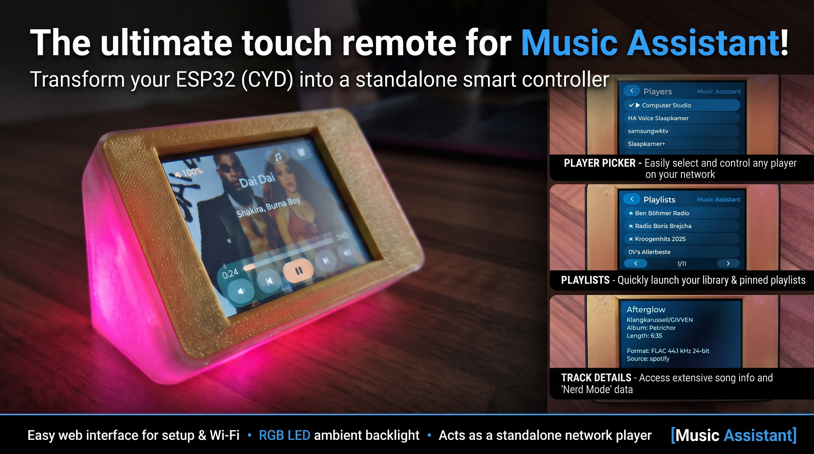
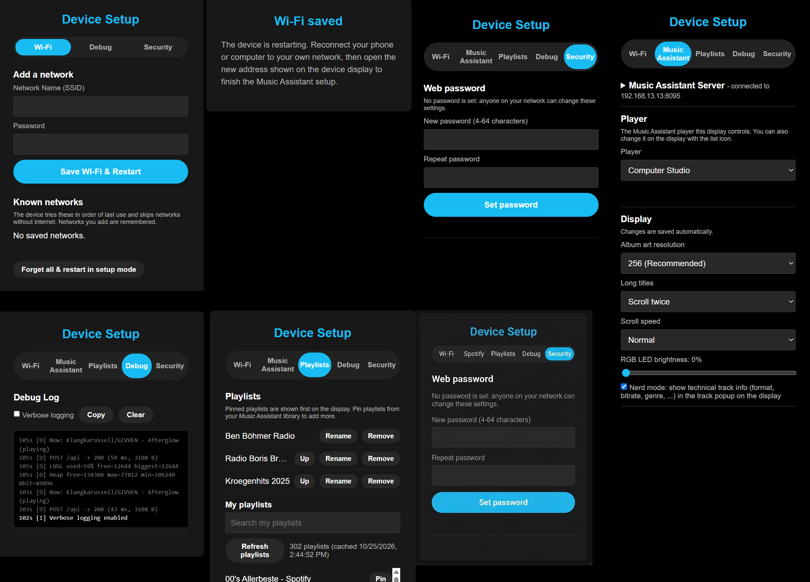

[](../../actions/workflows/build.yml)

# ESP32 Music Assistant Control



A standalone touch screen remote for [Music Assistant](https://music-assistant.io/) on the **ESP32-2432S028R** ("Cheap Yellow Display", CYD). It shows what is playing on one of your Music Assistant players and lets you control it: play/pause, skip, seek, volume, switch player and start playlists. The album art is used as a full-screen background.

The ESP32 does not play audio itself. It talks to your Music Assistant server over your home network.

## Features

- Now playing screen with title, artist, progress bar and album art as full-screen background. The accent colour is Music Assistant blue.
- Play/pause, previous/next, volume up/down, and **seek by tapping the progress bar**.
- Long titles and artists scroll when a track starts, then stop and show the beginning of the text. The number of runs and the speed are configurable.
- **Player picker**: choose any Music Assistant player. Players that are playing are listed first and marked with a play symbol.
- **Playlists**: pinned playlists are shown first, the rest of your library can be loaded in pages of 50 ("Load more"). Unavailable or empty playlists are hidden.
- **Track details popup** (tap title or artist): artist, album and length. With **Nerd mode** on it also shows format, bitrate, file size, source, loudness, genre, release date, label, track number, play count, ISRC, URI and queue state. The popup follows the next track automatically and can be scrolled.
- **Device info popup** (long press anywhere): IP address, Wi-Fi signal, MAC, uptime, heap and Music Assistant status.
- **RGB LED ambient light**: the LED on the back of the board follows the accent colour of the album art (brightness 0-100%, 0 = off).
- **Web interface** for setup, with tabs:
  - **Wi-Fi**: network credentials and known networks.
  - **Music Assistant**: server and sign-in (collapses when connected), player selection, and display options (album art resolution, scrolling, LED brightness, nerd mode).
  - **Playlists**: pin playlists from your library. Pins can be renamed and reordered.
  - **Debug**: in-browser log with verbose mode and a copy button. Logs are only kept in RAM.
  - **Security**: optional password for the web interface (none by default).
- Characters outside the built-in font (emoji, CJK) are dropped instead of drawn as boxes. Latin, Cyrillic, Greek and common symbols are supported.

### Web interface

The setup pages work on a phone or computer.



## Hardware

Designed for the **ESP32-2432S028R** (ESP32-WROOM-32, 4 MB flash, no PSRAM, 2.8" 320x240 ILI9341 display, XPT2046 resistive touch, USB-to-serial CH340).

### 3D-printed case

The case in the photos is **[CYD Desk Buddy for Bambu Lab](https://makerworld.com/en/models/2787810-cyd-desk-buddy-for-bambu-lab-home-assistant#profileId-3099382)** by **[annaglyph](https://makerworld.com/en/@annaglyph)** on MakerWorld. It is a desk stand for the Cheap Yellow Display that leaves the touch screen and the BOOT button reachable.

All credit for the model goes to annaglyph. The model files are not part of this repository; download them from the MakerWorld page, where the model's own licence and print settings also apply. This project is not affiliated with the case designer.

---

# Easy setup (flash an image)

No tools to build, only a browser and a USB cable.

## 1. Flash the firmware

Download `music-assistant-control-firmware.bin` from the latest [release](../../releases) of this repository. It is a single image with bootloader, partition table and app, to be written at offset `0x0`.

Use Chrome or Edge on a desktop computer (Web Serial is required) and connect the board over USB.

**esptool-js** (<https://espressif.github.io/esptool-js/>):

1. Press **Connect** and select the serial port of the board (CH340).
2. Set **Flash Address** to `0x0` and choose `music-assistant-control-firmware.bin` as the file.
3. Press **Program** and wait until it reports 100%.
4. **Unplug the USB cable and plug it in again** to start the firmware.

Notes:

- The address must be `0x0`. The merged image already contains the bootloader (normally at `0x1000`), so flashing it at `0x1000` shifts everything and the screen stays black. esptool-js then warns `Image file at 0x1000 doesn't look like an image file`.
- On this board the automatic reset after flashing does not restart the chip, and the RST button does not either. Power-cycle the board by reconnecting USB.
- If the board is not listed, install the CH340 USB driver. If flashing does not start, hold the BOOT button while pressing Connect.

## 2. Connect to Wi-Fi

1. On first boot the device starts an access point named **`MusicAssistant-Control-Setup`** and shows the instructions and its IP address on screen.
2. Connect your phone or computer to that network and open `http://192.168.4.1`.
3. On the **Wi-Fi** tab enter your network name and password. The device restarts and shows its new IP address on screen.

## 3. Connect to Music Assistant

Open `http://<device-ip>` in a browser on your home network and go to the **Music Assistant** tab.

1. Enter the **server address** as your browser reaches it on your home network, for example `192.168.1.10:8095`. An `https://` address and a path prefix also work.
2. Sign in with one of these:
   - **Username and password** of your Music Assistant account.
   - **Access token**: create one in Music Assistant under *Settings > Profile > Long-lived access tokens* and paste it.
   - **Sign in with Home Assistant**: the browser opens the Home Assistant login and returns to the device when done. Use the same address for the server as your browser uses to reach Music Assistant.
3. Pick the **player** this display controls. You can change it later with the player icon on the display.

The device stores only an access token, not your password.

Pin playlists on the **Playlists** tab and tune the display on the **Music Assistant** tab (see [Settings](#settings)).

---

# Advanced setup

## Build with PlatformIO

[PlatformIO](https://platformio.org/) is required to build from source.

```bash
pip install platformio
git clone <this repository>
cd "Music Assistant Control"
python -m platformio run -t upload
```

PlatformIO downloads the toolchain and all libraries on the first build. Use `python -m platformio device monitor` for the serial console (115200 baud). Add `--upload-port COM6` (your port) to `run -t upload` if the board is not detected automatically.

To create a single flashable image yourself:

```bash
python ~/.platformio/packages/tool-esptoolpy/esptool.py --chip esp32 merge_bin -o firmware-merged.bin \
  --flash_mode dio --flash_freq 40m --flash_size 4MB \
  0x1000 .pio/build/cyd/bootloader.bin \
  0x8000 .pio/build/cyd/partitions.bin \
  0xe000 ~/.platformio/packages/framework-arduinoespressif32/tools/partitions/boot_app0.bin \
  0x10000 .pio/build/cyd/firmware.bin
```

Flash it with esptool (`pip install esptool`):

```bash
esptool.py --chip esp32 --baud 460800 write_flash 0x0 firmware-merged.bin
```

The firmware uses the `huge_app.csv` partition table (3 MB app, ~0.9 MB LittleFS, no OTA).

## Board and pins

The pin configuration is set with build flags in [platformio.ini](platformio.ini):

| Function | GPIO |
|---|---|
| TFT MOSI / MISO / SCLK / CS / DC | 13 / 12 / 14 / 15 / 2 |
| TFT backlight | 21 |
| Touch CLK / MOSI / MISO / CS / IRQ | 25 / 32 / 39 / 33 / 36 |

Board variants: some CYD boards use an ST7789 display instead (often the ones with two USB ports) and may need a different driver and display inversion (`ST7789_DRIVER`, `TFT_INVERSION_ON`). If colours look inverted on an ILI9341 board, add `-DTFT_INVERSION_ON` to `build_flags`. Touch orientation and calibration are in [src/display.cpp](src/display.cpp).

## Music Assistant connection

The firmware uses the Music Assistant HTTP JSON API (`POST /api` with `{"command": ..., "args": ...}` and a bearer token) plus `/info` and `/auth/*` for sign-in. Players are read with `players/all` and `players/get`, playback is controlled with `players/cmd/*` and `player_queues/*`, and album art comes from the image proxy at the resolution you configure (80, 256 or 512 px). Nerd mode additionally reads `player_queues/get`.

- Only players that are available, enabled and not hidden in the UI are listed.
- Home Assistant sign-in uses `/auth/authorize?provider_id=homeassistant`. Music Assistant redirects the browser to `http://<device-ip>/ma-callback`, where the device receives its token. Music Assistant may ask you to confirm the redirect.
- A Home Assistant ingress or Nabu Casa link (for example `https://<id>.ui.nabu.casa/...`) only serves the web page and cannot be used by the device. Use the address of the server on your home network.
- Large responses (the player list, playlist pages) are streamed to LittleFS and parsed with a filter to save RAM.

## Settings

All settings are on the **Music Assistant** tab and are saved as soon as you change them.

- **Album art resolution**: 80, 256 (default) or 512 px. Images are downloaded to a temporary flash file, decoded and deleted again.
- **Long titles**: off, scroll 1, 2 or 3 times, or keep scrolling. Speed: slow, normal or fast. Applies from the next track.
- **RGB LED brightness**: 0-100%.
- **Nerd mode**: shows extra technical track info in the track popup on the display.
- **Pinned playlists** (Playlists tab): pinned playlists appear first on the display and play without any lookup.

## Wi-Fi management

The device remembers up to 8 networks. Every network you add (Wi-Fi tab, in setup mode or when connected) is saved. At boot it scans for the saved networks, tries the ones in range in order of last use, and checks that the connection really has internet access. A network that connects but has no internet (for example a guest Wi-Fi with a captive portal) is skipped in favour of the next one; if no saved network has internet it stays on the best one so you can still reach the settings.

If the saved network cannot be reached, the device falls back to the access point. If nobody connects to it for 5 minutes it restarts and tries the saved network again.

If the current network has no working internet, the screen shows "No internet. Long-press the screen to forget this Wi-Fi." and the device also starts the `MusicAssistant-Player-Setup` access point next to the normal connection after about 2 minutes. To leave the network:

- **On the device:** long-press the screen to open the device info popup and tap **Forget Wi-Fi** twice (the second tap confirms). This forgets only the connected network; the device then restarts and joins another saved network, or starts setup mode if there is none.
- **BOOT button:** hold the BOOT button on the back of the board for 3 seconds. This forgets the connected network **and removes the web password**, so it is also the way back in when you forgot the password.
- **Web interface:** on the Wi-Fi tab use **Forget & disconnect** next to the connected network, or **Forget all & restart in setup mode**.

Forgetting a network removes only Wi-Fi credentials. Your Music Assistant login, pins and settings are kept.

## Web password

Out of the box the web interface has no password. To add one, open the **Security** tab, enter a password (4-64 characters) twice and press **Set password**. The browser then asks for a login: the username can be anything (for example `admin`), the password is the one you set.

- The password protects every page and endpoint, including setup mode on the access point.
- It is stored as a salted SHA-256 hash, never as plain text. After a burst of wrong attempts the device temporarily answers with "Too many attempts" for 30 seconds.
- Forgot it? Hold the BOOT button for 3 seconds (this also forgets the connected Wi-Fi network).
- The login uses HTTP Basic authentication over plain HTTP, so the password is sent unencrypted on your network. It keeps casual users and other devices out; it does not protect against someone sniffing your Wi-Fi traffic.

## Using the device

| Action | Result |
|---|---|
| Tap play / prev / next / volume buttons | Control playback on the selected player |
| Tap the progress bar | Seek to that position |
| Tap the speaker icon (top right) | Choose the player |
| Tap the list icon (top right) | Open playlists (pinned first, then "Load more") |
| Tap title or artist | Track details (swipe to scroll long content) |
| Long press (0.7 s) anywhere else | Device and network info |
| Tap a popup | Close it |

## Limitations

- Playlists from a provider that is unavailable in Music Assistant (for example a disconnected streaming service) are hidden. Pins that point to them cannot be played.
- Memory is tight on the ESP32 without PSRAM. Large responses are streamed through temporary flash files.
- With `https://` the connection is encrypted but the certificate is **not verified** (`setInsecure()`), so someone able to intercept your traffic could read the access token. HTTPS has not been tested against many setups.
- The setup access point is open, and the web interface has no password until you set one on the **Security** tab. Even with a password, the connection is plain HTTP, so use it on a network you trust.
- The access token is stored in the device flash.

## Troubleshooting

- Black screen after flashing: check that the merged image was written at `0x0` (not `0x1000`), then unplug and replug the USB cable.
- Open the **Debug** tab, enable *Verbose logging* and use *Copy* to share the log. Entries show HTTP status codes, timing and free heap.
- After an unexpected restart the log starts with the reset reason (panic, watchdog, brownout). A weak USB supply can cause brownouts.
- "Cannot play this playlist": the playlist is empty or its provider is unavailable in Music Assistant.
- Player list empty or "Timed out waiting for Music Assistant": check that the server address is reachable from the device and that the token is still valid. Sign in again on the **Music Assistant** tab.
- Locked out of the web interface: use any username with the password. If you forgot it, hold the BOOT button for 3 seconds to remove the password (this also forgets the connected Wi-Fi network).

## Project layout

```
platformio.ini        Board, libraries, display pin build flags
include/lv_conf.h     LVGL configuration
src/main.cpp          State machine (setup AP -> Wi-Fi -> Music Assistant ready)
src/ma.*              Music Assistant API client (runs in its own task)
src/ui.*              LVGL screens, popups, lists, album art
src/web_portal.*      Web interface and JSON endpoints
src/config.*          Settings and pinned playlists (LittleFS)
src/app_log.*         In-RAM log shown in the browser
src/display.*         TFT and touch drivers for LVGL
src/fonts/            Generated LVGL fonts
```

The fonts in `src/fonts` are generated with `lv_font_conv` from Montserrat and DejaVu Sans (see the header of each file for the exact command).

## Credits and licence

Built with [LVGL](https://lvgl.io/), [TFT_eSPI](https://github.com/Bodmer/TFT_eSPI), [TJpg_Decoder](https://github.com/Bodmer/TJpg_Decoder), [ArduinoJson](https://arduinojson.org/), [ESPAsyncWebServer](https://github.com/ESP32Async/ESPAsyncWebServer) and [XPT2046_Touchscreen](https://github.com/PaulStoffregen/XPT2046_Touchscreen).

Case: [CYD Desk Buddy for Bambu Lab](https://makerworld.com/en/models/2787810-cyd-desk-buddy-for-bambu-lab-home-assistant#profileId-3099382) by [annaglyph](https://makerworld.com/en/@annaglyph).

Not affiliated with or endorsed by Music Assistant or the Open Home Foundation.

Released under the GNU General Public License v3.0, see [LICENSE](LICENSE).
